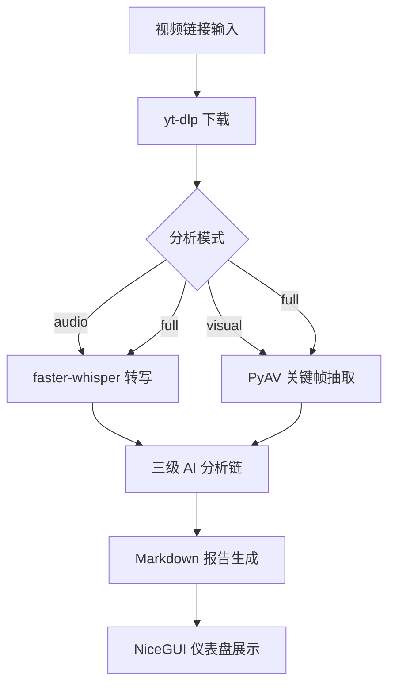
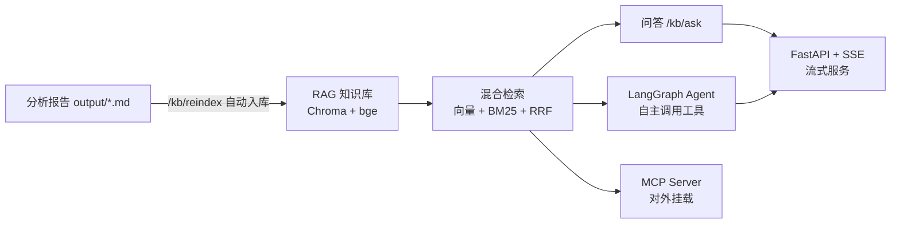

# video-analyzer 架构设计

视频链接 → 下载 → 转写/抽帧 → 三级 AI 分析 → Markdown 深度报告。

本仓库公开项目的**架构设计、工程决策和踩坑经验**，不包含可运行源码。

---

## 系统架构



## 核心设计决策

### 1. 多模型有序兜底链

**问题**：单一 LLM API 存在额度耗尽、网络超时、模型降级等不可控因素。

**方案**：构建有序兜底链，按优先级逐个尝试，未配 Key 的层自动跳过。

```
主力（百炼 qwen-plus）
  ↓ 失败/额度耗尽
兜底①（DeepSeek v4-pro）
  ↓ 失败
兜底②（智谱 GLM-4-Flash，免费）
```

**关键约束**：
- 所有模型统一走 OpenAI Compatible API 协议，切换只改 base_url + model 名
- 每层独立配置 temperature / max_tokens，不共享
- Key 从环境变量读取（`api_key_env` 字段指定变量名），配置文件不存明文
- 兜底触发条件：HTTP 4xx/5xx、超时、额度不足错误码

**踩坑**：百炼业务空间专属 Key（`sk-ws-` 前缀）必须配合专属域名 `ws-{id}.cn-beijing.maas.aliyuncs.com`，用通用域名会 403。这个错误码不在标准兜底触发列表里，最初导致主力失败后不切换。

### 2. 三级分析链（Stage Pipeline）

**问题**：单次 Prompt 让 LLM "分析这个视频" 产出质量不可控，容易泛泛而谈。

**方案**：拆成 3 级分析链，每级有独立 Prompt（YAML）和输入输出契约；分析链之后再经报告精炼，另可选反馈复盘。

| 阶段 | 任务 | 输入 | 输出 |
|------|------|------|------|
| Stage 1 | 真实性判断 | 转写文本 | 真/假/存疑 + 依据 |
| Stage 2 | 提炼总结 | 转写文本 + Stage1 结论 | 结构化摘要 |
| Stage 3 | 关联分析 | 摘要 + 用户画像 | 与用户的相关性/启发/深思 |
| 报告精炼（refiner） | 收敛成稿 | 三级输出 | 最终 Markdown（结论置顶） |
| 反馈复盘（feedback，可选） | 用户反馈迭代 | 报告 + 反馈 | 复盘记录 |

**设计原则**：
- 结论置顶，不给行动建议（用户明确要求）
- 无关内容直说"无关"，不硬凑
- 每级 Prompt 存为独立 YAML 文件，改 Prompt 不动代码
- 用户画像（`user_profile.yaml`）驱动 Stage 3 的个性化关联判断

**踩坑**：max_tokens 设 4096 时 Stage 输出被截断，后续 Stage 拿到不完整输入导致逻辑断裂。改为 8192 并在每级输出后做完整性校验（检查 JSON/Markdown 结构是否闭合）。

**分析链上的三处增强**：

- **多模态一致性冲突检测**：`full` 模式下 Stage1 之前，先把转写稿与关键帧视觉描述一起送模型找矛盾点（`CONFLICT_SYSTEM` / `_detect_conflict`），把"说的和画的对不对得上"作为真实性判据，而不是只信语音一路。
- **长视频分段提炼（map-reduce 的 map）**：超阈值（12000 字/段）的转写稿先逐段 LLM 压缩、保信息再去冗余，然后才进分析链；短视频零改动。避免硬截断丢内容，也控住 token 成本。
- **Stage1 结构化输出**：真实性判断走 Pydantic schema 约束 + 别名归一，产出真/假/存疑的可解析契约而非自由文本，方便下游按字段消费。

**取消信号穿透兜底链**：仪表盘的"停止"用继承 `BaseException` 的自定义异常（`_AnalysisCancelled`）抛出，专门绕过兜底链里宽 `except Exception`——否则取消会被当成"这个模型失败了"继续去烧下一个兜底 provider 的 token。

### 3. Token 用量追踪

**问题**：多模型多阶段调用，成本不透明。

**方案**：TokenTracker 单例，每次 LLM 调用后 record(model, prompt_tokens, completion_tokens)，报告头部输出汇总。

```
本次 token 消耗 12,847 | qwen-plus 8,231（入5,102/出3,129）| deepseek-v4-pro 4,616（入2,880/出1,736）
```

**设计取舍**：不做实时费用换算（各模型定价随时变），只记录 token 数，费用让用户自己按当时价格算。

### 4. 三种分析模式

| 模式 | 触发场景 | 处理链路 |
|------|---------|---------|
| audio | 播客/讲座/访谈类 | 下载 → 转写 → 分析链 |
| visual | 无语音/画面为主 | 下载 → 抽帧 → 视觉模型描述 → 分析链 |
| full | 默认，语音+画面都有 | 下载 → 转写 + 抽帧 → 合并 → 分析链 |

**模式选择**：给链接后 AI 自动判断（基于视频元数据的 duration/has_audio/resolution），不问用户。

### 5. 仪表盘与进度反馈

**问题**：完整 pipeline 跑一次 3-10 分钟，用户不知道卡在哪。

**方案**：NiceGUI 实时仪表盘，显示当前阶段、已用时间、token 消耗、模型状态。

**踩坑**：NiceGUI 的 WebSocket 连接在长时间无输出时会断开（代理超时）。加了心跳包（每 15s 发一次空更新）保活。

---

## 检索增强与 Agent 化（RAG / Agent / 评估 / 服务化 / MCP）

> 前面的三级分析链解决"单个视频这一次怎么看"；这一节解决"看过的所有内容如何变成可问答、可被 Agent 调用的知识资产"。项目已积累大量转写稿与分析报告，光靠一次性消费会浪费——于是补齐了 RAG 知识库、LangGraph Agent、RAGAS 口径评估、FastAPI+SSE 服务化，并把能力再封装成 MCP 工具。



### 6. RAG 知识库：把产出变成可问答的资产

**问题**：转写稿和报告越攒越多，但只会"生成一次就放着"，没法基于历史内容追问。

**方案**：把已产出的文本向量化入库，做检索增强问答闭环。

- **向量模型**：BAAI `bge-small-zh-v1.5`（~100MB，CPU 可跑，中文友好，零 API 成本）；精度升级路径是 `bge-large-zh` / `bge-m3`。
- **bge 的非对称用法**（最容易做错的一点）：官方建议**查询侧**加检索指令前缀"为这个句子生成表示以用于检索相关文章："，**文档侧不加**。两边都不加或都加都会拉低召回。
- **向量归一化 + Chroma cosine 空间**：向量已归一化，cosine 距离等价于按点积相似度排序。
- **分块**：按段落贪心打包（~500 字/块），超长段按中文句末标点（。！？；）再切，相邻块保留 80 字重叠，保持上下文完整，不硬切句子。
- **混合检索**：向量召回（管"语义像不像"）+ BM25 关键词召回（管"关键词命没命中"，中文按单字+二元组分词），用 **RRF（Reciprocal Rank Fusion）** 融合排名：`score(d) = Σ 1/(k + rank)`，k 取 60（论文经验值）抑制头部排名独大。两路互补——向量抓语义近似，BM25 兜住专有名词/数字这类精确命中。
- **问答**：检索到的片段拼进 prompt，约束模型"只依据资料答、资料没有就说未提及、末尾用 [编号] 标注引用"，并回传引用来源。
- **可测性设计**：LLM 以 `callable(system, user) -> str` 注入，RAG 模块不强绑具体模型和网络，因此可以完全离线跑测试。

**踩坑**：首次运行要下载 bge 模型，直连 HuggingFace 会卡死。模块内 `os.environ.setdefault("HF_ENDPOINT", "https://hf-mirror.com")` 兜底走国内镜像，不依赖外部是否配置。

### 7. Agent 化：从固定流水线到 LangGraph ReAct

**问题**：`下载 → 转写 → 分析` 写死成固定顺序，用户想"把上周那几个讲 X 的视频里关于 Y 的部分捞出来对比"这类动态需求时，硬编码流程接不住。

**方案**：把能力封装成 tools，交给大模型根据用户指令**自主决定调用哪个、按什么顺序、何时结束**。

用 LangGraph 的 `StateGraph` 把 ReAct 循环表达成一张图：

```
agent 节点（模型思考）
  → tools_condition 判断：
      模型请求工具 → tools 节点执行 → 结果回喂 agent → 再思考
      模型直接作答 → END
```

- **工具复用已有能力**：`search_kb`（查第 6 节的 RAG 知识库）、`count_text`（精确字符/中文字/英文词/token 统计）、`format_timestamp`（秒 → MM:SS）。
- **@tool 的 docstring 是给模型看的"工具说明书"**——写清"什么时候该调用我"直接决定模型会不会正确调用，这部分比函数体更值得打磨。
- **防失控**：`recursion_limit`（默认 12）限制最大轮数防死循环；工具自带失败容错。

**取舍**：工具返回统一用字符串而非结构化对象——模型读文本即可，省掉 schema 维护成本。

### 8. RAG 评估：RAGAS 同口径的轻量自实现

**问题**：RAG 搭完不知道好不好，调参全靠感觉。

**方案**：按 RAGAS 指标口径做**分层评估**。

| 层级 | 指标 | 怎么算 | 是否花模型钱 |
|------|------|--------|-------------|
| 检索层 | recall@k / precision@k | top-k 覆盖了多少"该被召回的来源"，纯确定性计算 | 否 |
| 生成层 | faithfulness（忠实度） | 答案里有多少论断能被检索上下文支撑（治幻觉），LLM-as-judge 0~1 | 是 |
| 生成层 | answer relevancy（相关性） | 答案是否切题，LLM-as-judge 0~1 | 是 |

裁判模型输出解析做鲁棒兜底：先抠 JSON 里的 `score`，抠不到再退化成正则抓 0~1 数字，避免裁判偶尔不守格式就整批失败。

**为什么不用 ragas 库**：ragas 会拉入它自己的 langchain 版本约束，和本项目 `langchain-core 1.6` 栈冲突、动摇已经跑通的 RAG/Agent；而且自实现逼自己真正理解每个指标的定义。这点的工程价值在于"我能解释 RAGAS 的 faithfulness 和 relevancy 分别治什么问题，以及为什么不用现成库"，比"pip 装一下跑一遍"扛得住深挖。

### 9. 服务化与可观测：FastAPI + SSE

**问题**：只跑本地脚本，长文本问答没法渐进反馈，也无法对外提供能力。

**方案**：FastAPI 暴露一组端点：

- `POST /kb/build`：用给定语料重建知识库；
- `POST /kb/reindex`：扫描 `output/*.md` 自动入库，把"分析 → 自动入库 → 可问答"闭成环；
- `POST /kb/ask`：一次性问答；
- `POST /kb/ask/stream`：**SSE 流式**问答（打字机效果，先推 `event: sources` 引用，再逐 token 推 answer 增量）。

**自建极简自测页**：内联 HTML 零 CDN，避开 FastAPI 默认 `/docs` 从 jsdelivr 加载在国内白屏的问题。

**安全护栏**：默认只绑 `127.0.0.1`；对外/容器暴露时必须设 `API_TOKEN`，否则任何人都能刷 `/kb/ask` 烧 LLM 额度。护栏分层：端点统一走 `X-API-Token` 鉴权（不匹配 401，`API_TOKEN` 为空则退化为"仅本机安全"并在非回环绑定打醒目告警）、滑动窗口限流（`RATE_LIMIT`，超限 429）、请求体上限（`MAX_BUILD_ITEMS`/`MAX_ITEM_CHARS`，超限 400）。

**Docker 边界**：容器只打包 RAG FastAPI 服务（`src/api.py`），不含 whisper/yt-dlp 主流程；日常开发测试走 conda/.venv，只有专门验证容器部署时才 `compose up`。

### 10. MCP 工具化：一份能力，多个出口

把 `search_kb` / `count_text` / `format_timestamp` 用 MCP Python SDK v2（`MCPServer`，原 FastMCP 改名）封装成 Model Context Protocol 工具，`mcp.run(transport="stdio")`。任何支持 MCP 的客户端（Claude Desktop、各类 Agent）都能直接挂载调用。同一批能力，LangGraph 内部编排用一套、对外以 MCP 暴露又是一套出口——工具说明复用 docstring，不重复实现。

---

## 工程约束与取舍

| 决策 | 选择 | 放弃的方案 | 原因 |
|------|------|-----------|------|
| 转写引擎 | faster-whisper (GPU) | OpenAI Whisper API | 本地运行无额度限制，large-v3 已缓存 |
| 视频下载 | yt-dlp | 各平台 SDK | 统一接口，cookies 走 Netscape 格式文件 |
| 报告格式 | Markdown | HTML/PDF | 用户要求一屏读完，MD 最轻量 |
| GUI 框架 | NiceGUI | Streamlit/Gradio | 支持 WebSocket 实时推送，不需要轮询 |
| 配置管理 | YAML + 环境变量 | .env 全量 | 结构化配置（模型链、Prompt）用 YAML，密钥用环境变量 |

---

## 已知限制

- 抖音 cookies 约每月需刷新一次；已提供一键刷新工具（`tools/refresh_douyin_cookies.py`，Playwright + Edge 扫码自动导出 Netscape cookies 并真实解析验证，旧文件自动备份）。更本质的限制是：抖音 detail 接口风控严格，同一套有效 cookies 也会间歇返回 403，下载/验证侧已做有限次重试。
- B站免 cookies 但有频率限制，批量下载会触发风控
- 视觉模式依赖 qwen-vl 多模态模型，免费额度有限
- 用户画像通过仪表盘「我的画像」编辑器在线编辑 `user_profile.yaml`（保存前用 `yaml.safe_load` 校验语法、写前自动备份 `.bak`）；改完**下次分析即生效**——单次运行内不热重载，也不回改已生成的报告，不是进程内实时更新。
