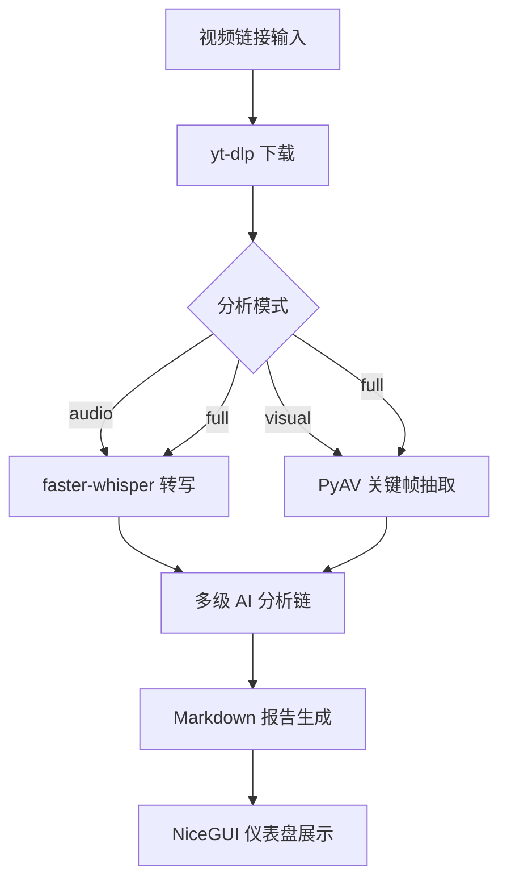

# video-analyzer 架构设计

视频链接 → 下载 → 转写/抽帧 → 多级 AI 分析 → Markdown 深度报告。

本仓库公开项目的**架构设计、工程决策和踩坑经验**，不包含可运行源码。

---

## 系统架构



## 核心设计决策

### 1. 多模型有序兜底链

**问题**：单一 LLM API 存在额度耗尽、网络超时、模型降级等不可控因素。

**方案**：构建有序兜底链，按优先级逐个尝试，未配 Key 的层自动跳过。

```
主力（百炼 qwen-plus）
  ↓ 失败/额度耗尽
兜底①（DeepSeek v4-pro）
  ↓ 失败
兜底②（智谱 GLM-4-Flash，免费）
```

**关键约束**：
- 所有模型统一走 OpenAI Compatible API 协议，切换只改 base_url + model 名
- 每层独立配置 temperature / max_tokens，不共享
- Key 从环境变量读取（`api_key_env` 字段指定变量名），配置文件不存明文
- 兜底触发条件：HTTP 4xx/5xx、超时、额度不足错误码

**踩坑**：百炼业务空间专属 Key（`sk-ws-` 前缀）必须配合专属域名 `ws-{id}.cn-beijing.maas.aliyuncs.com`，用通用域名会 403。这个错误码不在标准兜底触发列表里，最初导致主力失败后不切换。

### 2. 多级分析链（Stage Pipeline）

**问题**：单次 Prompt 让 LLM "分析这个视频" 产出质量不可控，容易泛泛而谈。

**方案**：拆成阶段化流水线，每级有独立 Prompt 和输入输出契约。

| 级别 | 任务 | 输入 | 输出 |
|------|------|------|------|
| Stage 1 | 真实性判断 | 转写文本 | 真/假/存疑 + 依据 |
| Stage 2 | 内容总结 | 转写文本 + Stage1 结论 | 结构化摘要 |
| Stage 3 | 关联分析 | 摘要 + 用户画像 | 与用户的相关性判断 |
| Stage 4 | 深度挖掘 | 前3级输出 | 启发/深思点 |
| Stage 5 | 报告精炼 | 全部输出 | 最终 Markdown |

**设计原则**：
- 结论置顶，不给行动建议（用户明确要求）
- 无关内容直说"无关"，不硬凑
- 每级 Prompt 存为独立 YAML 文件，改 Prompt 不动代码
- 用户画像（`user_profile.yaml`）驱动 Stage 3/4 的个性化判断

**踩坑**：max_tokens 设 4096 时 Stage 输出被截断，后续 Stage 拿到不完整输入导致逻辑断裂。改为 8192 并在每级输出后做完整性校验（检查 JSON/Markdown 结构是否闭合）。

### 3. Token 用量追踪

**问题**：多模型多阶段调用，成本不透明。

**方案**：TokenTracker 单例，每次 LLM 调用后 record(model, prompt_tokens, completion_tokens)，报告头部输出汇总。

```
本次 token 消耗 12,847 | qwen-plus 8,231（入5,102/出3,129）| deepseek-v4-pro 4,616（入2,880/出1,736）
```

**设计取舍**：不做实时费用换算（各模型定价随时变），只记录 token 数，费用让用户自己按当时价格算。

### 4. 三种分析模式

| 模式 | 触发场景 | 处理链路 |
|------|---------|---------|
| audio | 播客/讲座/访谈类 | 下载 → 转写 → 分析链 |
| visual | 无语音/画面为主 | 下载 → 抽帧 → 视觉模型描述 → 分析链 |
| full | 默认，语音+画面都有 | 下载 → 转写 + 抽帧 → 合并 → 分析链 |

**模式选择**：给链接后 AI 自动判断（基于视频元数据的 duration/has_audio/resolution），不问用户。

### 5. 仪表盘与进度反馈

**问题**：完整 pipeline 跑一次 3-10 分钟，用户不知道卡在哪。

**方案**：NiceGUI 实时仪表盘，显示当前阶段、已用时间、token 消耗、模型状态。

**踩坑**：NiceGUI 的 WebSocket 连接在长时间无输出时会断开（代理超时）。加了心跳包（每 15s 发一次空更新）保活。

---

## 工程约束与取舍

| 决策 | 选择 | 放弃的方案 | 原因 |
|------|------|-----------|------|
| 转写引擎 | faster-whisper (GPU) | OpenAI Whisper API | 本地运行无额度限制，large-v3 已缓存 |
| 视频下载 | yt-dlp | 各平台 SDK | 统一接口，cookies 走 Netscape 格式文件 |
| 报告格式 | Markdown | HTML/PDF | 用户要求一屏读完，MD 最轻量 |
| GUI 框架 | NiceGUI | Streamlit/Gradio | 支持 WebSocket 实时推送，不需要轮询 |
| 配置管理 | YAML + 环境变量 | .env 全量 | 结构化配置（模型链、Prompt）用 YAML，密钥用环境变量 |

---

## 已知限制

- 抖音 cookies 有效期短（约 7 天），过期后下载失败需要重新导出
- B站免 cookies 但有频率限制，批量下载会触发风控
- 视觉模式依赖 qwen-vl 多模态模型，免费额度有限
- 用户画像文件是静态 YAML，不支持运行时动态更新
